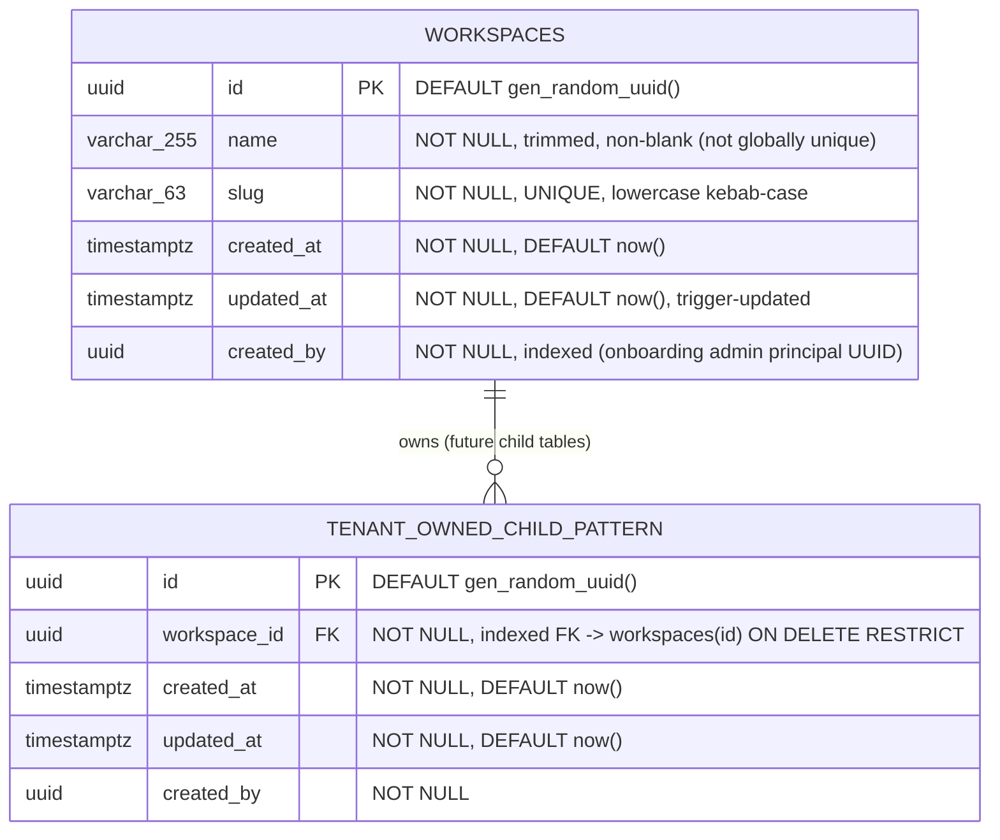

# AM-01 Database Schema & Data Dictionary (`S1-AM01-DB` / Jira `ND-168`)

- **Parent Story**: `AM-01` / Jira `ND-17` — Create isolated company workspace
- **Child Issue**: `S1-AM01-DB` / Jira `ND-168`
- **Alembic Migration Revision**: `0001_s1_am01_workspaces` ([`0001_s1_am01_create_workspaces.py`](../../migrations/versions/0001_s1_am01_create_workspaces.py))
- **ORM Model**: `Workspace` ([`app/models/workspace.py`](../../app/models/workspace.py))

---

## 1. Entity Relationship Diagram (ERD)

`workspaces` is the **tenant-root entity**. All tenant-owned child tables added in subsequent stories inherit [`TenantChildMixin`](../../app/db/base.py) and link back to `workspaces.id` via a `NOT NULL`, indexed `workspace_id` foreign key.

---

## 2. Data Dictionary: `workspaces`

### Columns

| Column | PostgreSQL Type | Nullable | Default | Constraints & Indexes | Description |
| :--- | :--- | :--- | :--- | :--- | :--- |
| `id` | `UUID` | `NOT NULL` | `gen_random_uuid()` | `PK` (`pk_workspaces`) | Immutable tenant/workspace primary identifier. |
| `name` | `VARCHAR(255)` | `NOT NULL` | — | `CHECK` (`ck_workspaces_name_not_blank`: `btrim(name) <> '' AND name = btrim(name)`) | Human-readable company display name. Intentionally **not** globally unique so distinct organizations may share a display name. |
| `slug` | `VARCHAR(63)` | `NOT NULL` | — | `UNIQUE` (`uq_workspaces_slug`), `CHECK` (`ck_workspaces_slug_format`: `slug ~ '^[a-z0-9]+(-[a-z0-9]+)*$' AND char_length(slug) >= 2`) | Agreed unique lowercase alphanumeric/hyphen machine identifier. |
| `created_at` | `TIMESTAMPTZ` | `NOT NULL` | `now()` | — | UTC-aware creation timestamp. |
| `updated_at` | `TIMESTAMPTZ` | `NOT NULL` | `now()` | `CHECK` (`ck_workspaces_updated_at_gte_created_at`: `updated_at >= created_at`), maintained by `trg_workspaces_set_updated_at` | UTC-aware last-modified timestamp (`clock_timestamp()` auto-advance on `UPDATE`). |
| `created_by` | `UUID` | `NOT NULL` | — | `INDEX` (`ix_workspaces_created_by`) | Authenticated onboarding administrator principal UUID (no `users` FK until user/membership schema exists). |

### Indexes

| Index Name | Columns | Type | Rationale |
| :--- | :--- | :--- | :--- |
| `pk_workspaces` | `(id)` | Primary Key B-tree | Tenant lookup and FK target for all child tables. |
| `uq_workspaces_slug` | `(slug)` | Unique B-tree | Enforces unique machine identifier and supports slug resolution. |
| `ix_workspaces_created_by` | `(created_by)` | Non-unique B-tree | Supports querying workspaces created by an onboarding administrator. |

> **Child Table Index Rule**: All future tenant-owned child tables using `TenantChildMixin` must lead every composite index with `workspace_id` (e.g., `(workspace_id, ...)`).

---

## 3. Architectural Decisions & Rationale

### 3.1 Option A — Explicit Tenant-Root Exception (`workspaces`)
- `workspaces` is keyed by `id` (`UUID`) and intentionally omits a self-referencing `workspace_id` column.
- Including a self-referencing `workspace_id = id` on the root table creates bootstrap friction during workspace creation, duplicates a 16-byte UUID and index on every row, and adds a risk of self-FK drift.
- Every tenant-owned child table added in future tickets must inherit `TenantChildMixin` (`id`, `workspace_id NOT NULL REFERENCES workspaces(id) ON DELETE RESTRICT`, `created_at`, `updated_at`, `created_by`).

### 3.2 `created_by` Bootstrapping
- No `users` or `memberships` table is part of `S1-AM01-DB`.
- `workspaces.created_by` stores the non-null `UUID` of the authenticated administrator principal supplied by the backend auth layer (`S1-AM01-BE`), never fabricated client-side. A foreign key constraint to `users(id)` can be added in the authentication/membership migration once that table exists.

### 3.3 External Source Provenance (`ExternalProvenanceMixin`)
- Company workspaces in `AM-01` are created natively inside FlowImmunity Nexus by an administrator; they do **not** originate from external ERP, CRM, or supplier integrations. Therefore `source_system`, `source_ref`, and source timestamps are **not** added to `workspaces` (avoiding invented placeholder values).
- For future entities ingested from external systems, [`ExternalProvenanceMixin`](../../app/db/base.py) defines the standard reusable pattern:
  - `source_system VARCHAR(64) NOT NULL`
  - `source_ref VARCHAR(255) NOT NULL`
  - `source_created_at TIMESTAMPTZ NULL`
  - `source_updated_at TIMESTAMPTZ NULL`
  - Paired with `UNIQUE (workspace_id, source_system, source_ref)` on the external child table.

---

## 4. Tenant Isolation & PostgreSQL RLS Boundary

### 4.1 Database-Level Enforcement (`S1-AM01-DB`)
1. **Restricted Non-Owner Role (`nexus_app_user`)**: Created with `NOLOGIN NOSUPERUSER NOCREATEDB NOCREATEROLE NOBYPASSRLS`, granted `SELECT, INSERT, UPDATE, DELETE` on `workspaces`.
2. **Forced RLS**: Both `ENABLE ROW LEVEL SECURITY` and `FORCE ROW LEVEL SECURITY` are enabled on `workspaces` so even the table owner (when non-superuser) is governed by policies.
3. **Transaction-Local Tenant Context**: Every request/transaction sets `app.current_workspace_id` via `SELECT set_config('app.current_workspace_id', :ws_id, true)` (implemented in [`set_tenant_context` / `tenant_transaction`](../../app/db/session.py)). Because `is_local = true`, PostgreSQL automatically clears the tenant context when the transaction commits or rolls back, preventing connection-pool bleed.
4. **Fail-Closed Policies**:
   - `SELECT`, `UPDATE`, and `DELETE` require `nullif(current_setting('app.current_workspace_id', true), '') IS NOT NULL AND id = nullif(current_setting('app.current_workspace_id', true), '')::uuid`.
   - Uncontextualized (`NULL` or `''`) queries return 0 rows and mutate 0 rows; malformed non-UUID strings fail closed with an `InvalidTextRepresentation` error.
   - `INSERT` requires `id` to match the transaction's `app.current_workspace_id` (`WITH CHECK`), preventing a tenant session from creating a workspace for another ID.
5. **Safe Onboarding Bootstrap**: During workspace creation (`AM-01`), the backend (`S1-AM01-BE`) must generate the new `workspace_id` server-side (never trusting a client-supplied workspace ID), open a transaction with `SET LOCAL ROLE nexus_app_user` and `set_config('app.current_workspace_id', <generated_uuid>, true)`, and insert the row with `id = <generated_uuid>`.

### 4.2 Boundary Owned by Sibling Tickets (`S1-AM01-BE` / `S1-AM01-QA`)
Database RLS cannot validate JWTs, session cookies, or HTTP authorization on its own. The following remain owned by `S1-AM01-BE` (`ND-169`) and `S1-AM01-QA` (`ND-171`):
- Authenticating the company administrator and deriving `created_by` from the verified auth token.
- Generating the new workspace UUID server-side during onboarding and binding `tenant_transaction` to the server-verified tenant ID per request.
- Ensuring the runtime PostgreSQL connection pool connects as a non-superuser role (`NOBYPASSRLS`) or assumes `nexus_app_user` via `SET LOCAL ROLE` on every request transaction.
- End-to-end API/UI multi-tenant isolation tests.
